# Tethys Retrieval — Interface Control Documents

Every boundary in the mission is controlled by one interface definition in `TethysInterfaces`; the segment-level usages are drawn in the [The system](TethysDocuments-SystemDescription.md#system)

## Interface definitions

*Interface definitions, one ICD each*

| name | documentation |
| --- | --- |
| TugInspectorInterface | Tug ↔ inspector before release, the electrical umbilical: keep-alive power, checkout data and the separation signal. The stowed stack's mechanical and thermal disciplines are InspectorDispenserInterface and InspectorThermalInterface, each a binary interface of its own so every usage stays a two-ended connect; the relay link takes over after release. |
| InspectorDispenserInterface | Tug ↔ inspector mechanical while stowed: the dispenser rails and release mechanism carrying Wren's launch loads into the tug structure. |
| InspectorThermalInterface | Tug ↔ inspector thermal while stowed: heat conducted through the dispenser rails that keeps Wren's battery above its survival temperature. |
| PropellantFeedInterface | Tank ↔ ground fill-and-drain: the xenon and hydrazine loading lines on the pad. |
| SpacecraftLauncherInterface | Stack ↔ launcher: adapter, loads, umbilical and separation. |
| SpaceGroundLink | Tug ↔ ground station: X/Ka-band telemetry, telecommand and ranging. |
| InspectorRelayLink | Inspector ↔ tug proximity link: imagery and radar data up, commands down. |
| CaptureInterface | Tug ↔ target body: the contact loads through the capture mechanism during capture, despin and the return thrust arcs. |
| DockingInterface | Tug ↔ visiting vehicle in the distant retrograde orbit. |
| PowerInterface | A unit on the power bus. |
| DataBusInterface | Two nodes on an on-board data bus. |
| ThermalInterface | Two units coupled by a strap, a radiator or a mount. |

*Interface ends and the port type at each*

**owner: TethysInterfaces::TugInspectorInterface**

| owner | name | type |
| --- | --- | --- |
| TethysInterfaces::TugInspectorInterface | tugSide | TethysInterfaces::UmbilicalPort |
| TethysInterfaces::TugInspectorInterface | inspectorSide | TethysInterfaces::UmbilicalPort |

**owner: TethysInterfaces::InspectorDispenserInterface**

| owner | name | type |
| --- | --- | --- |
| TethysInterfaces::InspectorDispenserInterface | tugSide | TethysInterfaces::MechanicalPort |
| TethysInterfaces::InspectorDispenserInterface | inspectorSide | TethysInterfaces::MechanicalPort |

**owner: TethysInterfaces::InspectorThermalInterface**

| owner | name | type |
| --- | --- | --- |
| TethysInterfaces::InspectorThermalInterface | tugSide | TethysInterfaces::ThermalPort |
| TethysInterfaces::InspectorThermalInterface | inspectorSide | TethysInterfaces::ThermalPort |

**owner: TethysInterfaces::PropellantFeedInterface**

| owner | name | type |
| --- | --- | --- |
| TethysInterfaces::PropellantFeedInterface | tankSide | TethysInterfaces::FluidPort |
| TethysInterfaces::PropellantFeedInterface | groundSide | TethysInterfaces::FluidPort |

**owner: TethysInterfaces::SpacecraftLauncherInterface**

| owner | name | type |
| --- | --- | --- |
| TethysInterfaces::SpacecraftLauncherInterface | spacecraftSide | TethysInterfaces::MechanicalPort |
| TethysInterfaces::SpacecraftLauncherInterface | launcherSide | TethysInterfaces::MechanicalPort |

**owner: TethysInterfaces::SpaceGroundLink**

| owner | name | type |
| --- | --- | --- |
| TethysInterfaces::SpaceGroundLink | spacecraftSide | TethysInterfaces::RfPort |
| TethysInterfaces::SpaceGroundLink | groundSide | TethysInterfaces::RfPort |

**owner: TethysInterfaces::InspectorRelayLink**

| owner | name | type |
| --- | --- | --- |
| TethysInterfaces::InspectorRelayLink | inspectorSide | TethysInterfaces::RfPort |
| TethysInterfaces::InspectorRelayLink | tugSide | TethysInterfaces::RfPort |

**owner: TethysInterfaces::CaptureInterface**

| owner | name | type |
| --- | --- | --- |
| TethysInterfaces::CaptureInterface | tugSide | TethysInterfaces::MechanicalPort |
| TethysInterfaces::CaptureInterface | bodySide | TethysInterfaces::MechanicalPort |

**owner: TethysInterfaces::DockingInterface**

| owner | name | type |
| --- | --- | --- |
| TethysInterfaces::DockingInterface | tugSide | TethysInterfaces::DockingPort |
| TethysInterfaces::DockingInterface | visitorSide | TethysInterfaces::DockingPort |

**owner: TethysInterfaces::PowerInterface**

| owner | name | type |
| --- | --- | --- |
| TethysInterfaces::PowerInterface | source | TethysInterfaces::PowerOutlet |
| TethysInterfaces::PowerInterface | load | TethysInterfaces::PowerOutlet |

**owner: TethysInterfaces::DataBusInterface**

| owner | name | type |
| --- | --- | --- |
| TethysInterfaces::DataBusInterface | a | TethysInterfaces::DataBusPort |
| TethysInterfaces::DataBusInterface | b | TethysInterfaces::DataBusPort |

**owner: TethysInterfaces::ThermalInterface**

| owner | name | type |
| --- | --- | --- |
| TethysInterfaces::ThermalInterface | hot | TethysInterfaces::ThermalPort |
| TethysInterfaces::ThermalInterface | cold | TethysInterfaces::ThermalPort |

*System-level interface usages*

| name |
| --- |
| launchAdapter |
| deepSpaceLink |
| capture |
| visitorDocking |

## Ports

*Port definitions*

| name | documentation |
| --- | --- |
| PowerOutlet | A power source port: power flows out, a load-current demand is reported back. |
| DataBusPort | A node on an on-board data bus. |
| RfPort | An antenna or transponder port. |
| ThermalPort | A conductive or radiative thermal interface. |
| MechanicalPort | A structural attachment: loads cross it, a separation signal may end it. |
| UmbilicalPort | The electrical umbilical across a separable interface: keep-alive power, checkout data and separation signals. |
| FluidPort | A propellant or pressurant line interface. |
| DockingPort | An androgynous docking interface: structural latch, power and data pass-through for the visiting vehicle. |

## Items crossing the interfaces

*Item definitions*

| name | documentation |
| --- | --- |
| ElectricalPower | Regulated or unregulated DC power on a bus. |
| Telemetry | Housekeeping or science data framed for a downlink or an on-board bus. |
| Telecommand | A command packet or a command file. |
| RfCarrier | A radio-frequency carrier with its modulation and power. |
| Heat | Conducted or radiated thermal power. |
| MechanicalLoad | Quasi-static, sine, random, shock or contact load at a mechanical interface. |
| Propellant | Pressurised propellant: xenon for the electric thrusters, hydrazine for the reaction control thrusters, pressurant gas for either. |

## Flight segment interfaces

*Tug ↔ inspector: carrier umbilical and relay link*

```mermaid
---
config:
  fontFamily: "Helvetica, Arial, sans-serif"
  theme: base
  themeCSS: ".edgeLabel rect { opacity: 1 !important; } .cluster-label .nodeLabel { text-align: center; }"
  themeVariables:
    fontFamily: "Helvetica, Arial, sans-serif"
    fontSize: "14px"
    primaryColor: "#FFFFFF"
    secondaryColor: "#FFFFFF"
    tertiaryColor: "#FFFFFF"
    background: "#FFFFFF"
    primaryBorderColor: "#181818"
    primaryTextColor: "#000000"
    lineColor: "#181818"
    textColor: "#000000"
    noteBkgColor: "#FEFFDD"
    noteBorderColor: "#181818"
    noteTextColor: "#000000"
    clusterBkg: "#FFFFFF"
    clusterBorder: "#181818"
    edgeLabelBackground: "#FFFFFF"
---
%% TethysViews::flightSegmentWiring — interconnection rendering (view def InterconnectionView)
flowchart LR
  subgraph n0 ["`*«part def»* **TethysFlightSegment**`"]
    direction LR
    subgraph n1 ["`*«part»* **tug**`"]
      direction LR
      n2("`*«attribute»*
**dryMass**`")
      n3("`*«attribute»*
**wetMass**`")
      subgraph n4 ["`*«part»* **structure**`"]
        direction LR
        n4.1["inspectorAttachment"]
        n5("`*«attribute»*
**mass**`")
      end
      subgraph n6 ["`*«part»* **thermal**`"]
        direction LR
        n6.1["inspectorThermal"]
        n6.2["power"]
        n7("`*«attribute»*
**mass**`")
      end
      subgraph n8 ["`*«part»* **eps**`"]
        direction LR
        n8.0["mainBus"]
        n8.1["highVoltageBus"]
        n8.2["inspectorKeepAlive"]
        n9("`*«attribute»*
**arrayPowerAtOneAu**`")
        n10("`*«attribute»*
**mass**`")
      end
      subgraph n11 ["`*«part»* **cdh**`"]
        direction LR
        n11.1["power"]
        n12("`*«attribute»*
**mass**`")
      end
      subgraph n13 ["`*«part»* **telecom**`"]
        direction LR
        n13.1["proximity"]
        n13.2["power"]
        n14("`*«attribute»*
**mass**`")
      end
      subgraph n15 ["`*«part»* **gnc**`"]
        direction LR
        n15.0["power"]
        n16("`*«attribute»*
**mass**`")
      end
      subgraph n17 ["`*«part»* **sep**`"]
        direction LR
        n17.1["power"]
        n18("`*«attribute»*
**xenonMass**`")
        n19("`*«attribute»*
**thrusterCount**`")
        n20("`*«attribute»*
**operatingThrusters**`")
        n21("`*«attribute»*
**specificImpulse**`")
        n22("`*«attribute»*
**maximumPower**`")
        n23("`*«attribute»*
**mass**`")
      end
      subgraph n24 ["`*«part»* **rcs**`"]
        direction LR
        n24.1["power"]
        n25("`*«attribute»*
**hydrazineMass**`")
        n26("`*«attribute»*
**mass**`")
      end
      subgraph n27 ["`*«part»* **captureSystem**`"]
        direction LR
        n27.1["power"]
        n28("`*«attribute»*
**maximumBodyDiameter**`")
        n29("`*«attribute»*
**maximumBodyMass**`")
        n30("`*«attribute»*
**mass**`")
      end
      subgraph n31 ["`*«part»* **sensors**`"]
        direction LR
        n31.0["power"]
        n32("`*«attribute»*
**mass**`")
      end
    end
    subgraph n33 ["`*«part»* **inspector**`"]
      direction LR
      n33.0["carrierAttachment"]
      n33.1["stowedThermal"]
      n34("`*«attribute»*
**wetMass**`")
      subgraph n35 ["`*«part»* **bus**`"]
        direction LR
        n35.0["proximity"]
        n35.1["umbilical"]
        n36("`*«attribute»*
**mass**`")
      end
      subgraph n37 ["`*«part»* **payload**`"]
        direction LR
        n38("`*«attribute»*
**mass**`")
      end
      subgraph n39 ["`*«part»* **propulsion**`"]
        direction LR
        n40("`*«attribute»*
**mass**`")
        n41("`*«attribute»*
**propellantMass**`")
      end
    end
  end
  n8.0 === n11.1
  n8.0 === n13.2
  n8.0 === n15.0
  n8.0 === n6.2
  n8.0 === n24.1
  n8.0 === n27.1
  n8.0 === n31.0
  n8.1 === n17.1
  n8.2 === n35.1
  n4.1 === n33.0
  n6.1 === n33.1
  n35.0 === n13.1
  linkStyle 0 stroke-width:3px
  linkStyle 1 stroke-width:3px
  linkStyle 2 stroke-width:3px
  linkStyle 3 stroke-width:3px
  linkStyle 4 stroke-width:3px
  linkStyle 5 stroke-width:3px
  linkStyle 6 stroke-width:3px
  linkStyle 7 stroke-width:3px
  linkStyle 8 stroke-width:3px
  linkStyle 9 stroke-width:3px
  linkStyle 10 stroke-width:3px
  linkStyle 11 stroke-width:3px
```

