# Tethys Retrieval — System Description

Tethys Retrieval is a fictional asteroid-retrieval mission: the solar-electric tug Argent flies to the small near-Earth asteroid 2031 QX Amaranth, characterises it with the free-flying inspector Wren, captures and despins it, and returns it to a lunar distant retrograde orbit for the visiting vehicle Lantern. Every name and number is invented; the physics is not.

This document is *generated* from the SysML v2 model by `sysml -render-documents`; the interface set is [Interface definitions](TethysDocuments-InterfaceControlDocuments.md#interfaces) and the verification matrix [Requirements](TethysDocuments-VerificationMatrix.md#matrix)

## The system

The mission is one system of five segment-level parts: the flight segment (tug and inspector), the launch segment, the ground segment, the target body and the visiting vehicle that is external to the mission and present only through its docking interface.

*Segment-level parts of the system*

| name | documentation |
| --- | --- |
| flight |  |
| launch |  |
| ground |  |
| target |  |
| visitor |  |

*Segment-level interface control (positioned by TethysLayout)*

<figure class="sysml-diagram">
<svg width="1872pt" height="492pt"
 viewBox="0.00 0.00 1872.00 492.00" xmlns="http://www.w3.org/2000/svg" xmlns:xlink="http://www.w3.org/1999/xlink">
<g id="graph0" class="graph" transform="scale(1 1) rotate(0) translate(4 488)">
<title>TethysViews::segmentInterfaces</title>
<polygon fill="white" stroke="transparent" points="-4,4 -4,-488 1868,-488 1868,4 -4,4"/>
<g id="clust1" class="cluster">
<title>cluster_frame</title>
<polygon fill="none" stroke="black" stroke-width="0.5" points="952,0 952,-484 1864,-484 1864,0 952,0"/>
<text text-anchor="start" x="960" y="-469.8" font-family="Helvetica,sans-Serif" font-style="italic" font-size="10.00">«view»</text>
<text text-anchor="start" x="996" y="-469.8" font-family="Helvetica,sans-Serif" font-size="14.00"> </text>
<text text-anchor="start" x="1001" y="-469.8" font-family="Helvetica,sans-Serif" font-weight="bold" font-size="14.00">TethysViews::segmentInterfaces</text>
<text text-anchor="start" x="1257" y="-469.8" font-family="Helvetica,sans-Serif" font-size="14.00"> : InterfaceView</text>
</g>
<g id="clust2" class="cluster">
<title>cluster_n0</title>
<polygon fill="none" stroke="black" stroke-width="0.5" points="960,-40 960,-456 1856,-456 1856,-40 960,-40"/>
<text text-anchor="start" x="1006.5" y="-445" font-family="Helvetica,sans-Serif" font-style="italic" font-size="10.00">«part»</text>
<text text-anchor="start" x="968" y="-431.8" font-family="Helvetica,sans-Serif" font-weight="bold" font-size="14.00">tethysSystem</text>
</g>
<!-- n0 -->
<!-- n3 -->
<!-- collapsed -->
<g id="node2" class="node">
<title>n3</title>
<path fill="white" stroke="#181818" stroke-width="0.5" d="M1506,-448C1506,-448 1310,-448 1310,-448 1304,-448 1298,-442 1298,-436 1298,-436 1298,-340 1298,-340 1298,-334 1304,-328 1310,-328 1310,-328 1506,-328 1506,-328 1512,-328 1518,-334 1518,-340 1518,-340 1518,-436 1518,-436 1518,-442 1512,-448 1506,-448"/>
<text text-anchor="start" x="1392" y="-393" font-family="Helvetica,sans-Serif" font-style="italic" font-size="10.00">«part»</text>
<text text-anchor="start" x="1387" y="-379.8" font-family="Helvetica,sans-Serif" font-weight="bold" font-size="14.00">flight</text>
</g>
<!-- n4 -->
<!-- collapsed -->
<g id="node3" class="node">
<title>n4</title>
<path fill="white" stroke="#181818" stroke-width="0.5" d="M1176,-448C1176,-448 980,-448 980,-448 974,-448 968,-442 968,-436 968,-436 968,-340 968,-340 968,-334 974,-328 980,-328 980,-328 1176,-328 1176,-328 1182,-328 1188,-334 1188,-340 1188,-340 1188,-436 1188,-436 1188,-442 1182,-448 1176,-448"/>
<text text-anchor="start" x="1062" y="-393" font-family="Helvetica,sans-Serif" font-style="italic" font-size="10.00">«part»</text>
<text text-anchor="start" x="1052" y="-379.8" font-family="Helvetica,sans-Serif" font-weight="bold" font-size="14.00">launch</text>
</g>
<!-- n3&#45;&gt;n4 -->
<g id="edge1" class="edge">
<title>n3&#45;&gt;n4</title>
<path fill="none" stroke="#181818" stroke-width="3" d="M1188,-388C1188,-388 1298,-388 1298,-388"/>
</g>
<!-- n5 -->
<!-- collapsed -->
<g id="node4" class="node">
<title>n5</title>
<path fill="white" stroke="#181818" stroke-width="0.5" d="M1506,-168C1506,-168 1310,-168 1310,-168 1304,-168 1298,-162 1298,-156 1298,-156 1298,-60 1298,-60 1298,-54 1304,-48 1310,-48 1310,-48 1506,-48 1506,-48 1512,-48 1518,-54 1518,-60 1518,-60 1518,-156 1518,-156 1518,-162 1512,-168 1506,-168"/>
<text text-anchor="start" x="1392" y="-113" font-family="Helvetica,sans-Serif" font-style="italic" font-size="10.00">«part»</text>
<text text-anchor="start" x="1380" y="-99.8" font-family="Helvetica,sans-Serif" font-weight="bold" font-size="14.00">ground</text>
</g>
<!-- n3&#45;&gt;n5 -->
<g id="edge2" class="edge">
<title>n3&#45;&gt;n5</title>
<path fill="none" stroke="#181818" stroke-width="3" d="M1408,-328C1408,-328 1408,-168 1408,-168"/>
</g>
<!-- n6.0 -->
<g id="node6" class="node">
<title>n6.0</title>
<polygon fill="white" stroke="#181818" stroke-width="0.5" points="1628,-394 1616,-394 1616,-382 1628,-382 1628,-394"/>
<text text-anchor="middle" x="1597" y="-396.6" font-family="Helvetica,sans-Serif" font-size="8.00">^surface</text>
</g>
<!-- n3&#45;&gt;n6.0 -->
<g id="edge3" class="edge">
<title>n3&#45;&gt;n6.0</title>
<path fill="none" stroke="#181818" stroke-width="3" d="M1518,-388C1518,-388 1628,-388 1628,-388"/>
</g>
<!-- n7.0 -->
<g id="node8" class="node">
<title>n7.0</title>
<polygon fill="white" stroke="#181818" stroke-width="0.5" points="1744,-180 1732,-180 1732,-168 1744,-168 1744,-180"/>
<text text-anchor="middle" x="1712" y="-182.6" font-family="Helvetica,sans-Serif" font-size="8.00">^docking</text>
</g>
<!-- n3&#45;&gt;n7.0 -->
<g id="edge4" class="edge">
<title>n3&#45;&gt;n7.0</title>
<path fill="none" stroke="#181818" stroke-width="3" d="M1518,-358C1518,-358 1738,-168 1738,-168"/>
</g>
<!-- n6 -->
<!-- collapsed -->
<g id="node5" class="node">
<title>n6</title>
<path fill="#f4e3c1" stroke="#8a6d3b" stroke-width="0.5" d="M1836,-448C1836,-448 1640,-448 1640,-448 1634,-448 1628,-442 1628,-436 1628,-436 1628,-340 1628,-340 1628,-334 1634,-328 1640,-328 1640,-328 1836,-328 1836,-328 1842,-328 1848,-334 1848,-340 1848,-340 1848,-436 1848,-436 1848,-442 1842,-448 1836,-448"/>
<text text-anchor="start" x="1722" y="-393" font-family="Helvetica,sans-Serif" font-style="italic" font-size="10.00">«part»</text>
<text text-anchor="start" x="1713" y="-379.8" font-family="Helvetica,sans-Serif" font-weight="bold" font-size="14.00">target</text>
</g>
<!-- n7 -->
<!-- collapsed -->
<g id="node7" class="node">
<title>n7</title>
<path fill="white" stroke="#181818" stroke-width="0.5" d="M1836,-168C1836,-168 1640,-168 1640,-168 1634,-168 1628,-162 1628,-156 1628,-156 1628,-60 1628,-60 1628,-54 1634,-48 1640,-48 1640,-48 1836,-48 1836,-48 1842,-48 1848,-54 1848,-60 1848,-60 1848,-156 1848,-156 1848,-162 1842,-168 1836,-168"/>
<text text-anchor="start" x="1722" y="-113" font-family="Helvetica,sans-Serif" font-style="italic" font-size="10.00">«part»</text>
<text text-anchor="start" x="1713" y="-99.8" font-family="Helvetica,sans-Serif" font-weight="bold" font-size="14.00">visitor</text>
</g>
<!-- note:0 -->
<g id="node9" class="node">
<title>note:0</title>
<polygon fill="white" stroke="#181818" stroke-width="0.5" points="1262,-68 968,-68 968,-8 1268,-8 1268,-62 1262,-68"/>
<polyline fill="none" stroke="#181818" stroke-width="0.5" points="1262,-68 1262,-62 "/>
<polyline fill="none" stroke="#181818" stroke-width="0.5" points="1268,-62 1262,-62 "/>
<text text-anchor="start" x="991.5" y="-49.3" font-family="Helvetica,sans-Serif" font-size="14.00">Segment&#45;level interface control: one</text>
<text text-anchor="start" x="1018.5" y="-34.3" font-family="Helvetica,sans-Serif" font-size="14.00">interface definition per edge</text>
<text text-anchor="start" x="1053" y="-19.3" font-family="Helvetica,sans-Serif" font-size="14.00">(TethysInterfaces).</text>
</g>
<!-- frame_tr -->
<g id="node10" class="node">
<title>frame_tr</title>
<polygon fill="white" stroke="transparent" stroke-width="0.5" points="1856,-456 1562,-456 1562,-420 1856,-420 1856,-456"/>
<text text-anchor="start" x="1618.5" y="-435.5" font-family="Helvetica,sans-Serif" font-size="10.00">expose TethysSystem::tethysSystem</text>
</g>
<!-- frame_br -->
<g id="node11" class="node">
<title>frame_br</title>
<polygon fill="white" stroke="transparent" stroke-width="0.5" points="1856,-44 0,-44 0,-8 1856,-8 1856,-44"/>
<text text-anchor="start" x="737" y="-34.5" font-family="Helvetica,sans-Serif" font-size="10.00">The system with its five segment&#45;level parts and the four top&#45;level interfaces:</text>
<text text-anchor="start" x="745" y="-23.5" font-family="Helvetica,sans-Serif" font-size="10.00">launch adapter, deep&#45;space link, capture and visitor docking. TethysLayout</text>
<text text-anchor="start" x="774.5" y="-12.5" font-family="Helvetica,sans-Serif" font-size="10.00">positions the parts, sizes the canvas and routes the interfaces.</text>
</g>
</g>
</svg>
</figure>

*The system's parts, ports and interfaces*

<figure class="sysml-diagram">
<svg width="920pt" height="460pt"
 viewBox="0.00 0.00 920.00 460.00" xmlns="http://www.w3.org/2000/svg" xmlns:xlink="http://www.w3.org/1999/xlink">
<g id="graph0" class="graph" transform="scale(1 1) rotate(0) translate(4 456)">
<title>TethysViewsTooling::systemOverview</title>
<polygon fill="white" stroke="transparent" points="-4,4 -4,-456 916,-456 916,4 -4,4"/>
<g id="clust1" class="cluster">
<title>cluster_frame</title>
<polygon fill="none" stroke="black" stroke-width="0.5" points="0,0 0,-452 912,-452 912,0 0,0"/>
<text text-anchor="start" x="8" y="-437.8" font-family="Helvetica,sans-Serif" font-style="italic" font-size="10.00">«view»</text>
<text text-anchor="start" x="44" y="-437.8" font-family="Helvetica,sans-Serif" font-size="14.00"> </text>
<text text-anchor="start" x="49" y="-437.8" font-family="Helvetica,sans-Serif" font-weight="bold" font-size="14.00">TethysViewsTooling::systemOverview</text>
</g>
<g id="clust2" class="cluster">
<title>cluster_n0</title>
<polygon fill="none" stroke="black" stroke-width="0.5" points="8,-8 8,-424 904,-424 904,-8 8,-8"/>
<text text-anchor="start" x="54.5" y="-413" font-family="Helvetica,sans-Serif" font-style="italic" font-size="10.00">«part»</text>
<text text-anchor="start" x="16" y="-399.8" font-family="Helvetica,sans-Serif" font-weight="bold" font-size="14.00">tethysSystem</text>
</g>
<!-- n0 -->
<!-- n1 -->
<!-- collapsed -->
<g id="node2" class="node">
<title>n1</title>
<path fill="white" stroke="#181818" stroke-width="0.5" d="M554,-416C554,-416 358,-416 358,-416 352,-416 346,-410 346,-404 346,-404 346,-308 346,-308 346,-302 352,-296 358,-296 358,-296 554,-296 554,-296 560,-296 566,-302 566,-308 566,-308 566,-404 566,-404 566,-410 560,-416 554,-416"/>
<text text-anchor="start" x="440" y="-361" font-family="Helvetica,sans-Serif" font-style="italic" font-size="10.00">«part»</text>
<text text-anchor="start" x="435" y="-347.8" font-family="Helvetica,sans-Serif" font-weight="bold" font-size="14.00">flight</text>
</g>
<!-- n2 -->
<!-- collapsed -->
<g id="node3" class="node">
<title>n2</title>
<path fill="white" stroke="#181818" stroke-width="0.5" d="M224,-416C224,-416 28,-416 28,-416 22,-416 16,-410 16,-404 16,-404 16,-308 16,-308 16,-302 22,-296 28,-296 28,-296 224,-296 224,-296 230,-296 236,-302 236,-308 236,-308 236,-404 236,-404 236,-410 230,-416 224,-416"/>
<text text-anchor="start" x="110" y="-361" font-family="Helvetica,sans-Serif" font-style="italic" font-size="10.00">«part»</text>
<text text-anchor="start" x="100" y="-347.8" font-family="Helvetica,sans-Serif" font-weight="bold" font-size="14.00">launch</text>
</g>
<!-- n1&#45;&gt;n2 -->
<g id="edge1" class="edge">
<title>n1&#45;&gt;n2</title>
<path fill="none" stroke="#181818" stroke-width="3" d="M236,-356C236,-356 346,-356 346,-356"/>
</g>
<!-- n3 -->
<!-- collapsed -->
<g id="node4" class="node">
<title>n3</title>
<path fill="white" stroke="#181818" stroke-width="0.5" d="M554,-136C554,-136 358,-136 358,-136 352,-136 346,-130 346,-124 346,-124 346,-28 346,-28 346,-22 352,-16 358,-16 358,-16 554,-16 554,-16 560,-16 566,-22 566,-28 566,-28 566,-124 566,-124 566,-130 560,-136 554,-136"/>
<text text-anchor="start" x="440" y="-81" font-family="Helvetica,sans-Serif" font-style="italic" font-size="10.00">«part»</text>
<text text-anchor="start" x="428" y="-67.8" font-family="Helvetica,sans-Serif" font-weight="bold" font-size="14.00">ground</text>
</g>
<!-- n1&#45;&gt;n3 -->
<g id="edge2" class="edge">
<title>n1&#45;&gt;n3</title>
<path fill="none" stroke="#181818" stroke-width="3" d="M456,-296C456,-296 456,-136 456,-136"/>
</g>
<!-- n4.0 -->
<g id="node6" class="node">
<title>n4.0</title>
<polygon fill="white" stroke="#181818" stroke-width="0.5" points="676,-362 664,-362 664,-350 676,-350 676,-362"/>
<text text-anchor="middle" x="645" y="-364.6" font-family="Helvetica,sans-Serif" font-size="8.00">^surface</text>
</g>
<!-- n1&#45;&gt;n4.0 -->
<g id="edge3" class="edge">
<title>n1&#45;&gt;n4.0</title>
<path fill="none" stroke="#181818" stroke-width="3" d="M566,-356C566,-356 676,-356 676,-356"/>
</g>
<!-- n5.0 -->
<g id="node8" class="node">
<title>n5.0</title>
<polygon fill="white" stroke="#181818" stroke-width="0.5" points="792,-148 780,-148 780,-136 792,-136 792,-148"/>
<text text-anchor="middle" x="760" y="-150.6" font-family="Helvetica,sans-Serif" font-size="8.00">^docking</text>
</g>
<!-- n1&#45;&gt;n5.0 -->
<g id="edge4" class="edge">
<title>n1&#45;&gt;n5.0</title>
<path fill="none" stroke="#181818" stroke-width="3" d="M566,-326C566,-326 786,-136 786,-136"/>
</g>
<!-- n4 -->
<!-- collapsed -->
<g id="node5" class="node">
<title>n4</title>
<path fill="#f4e3c1" stroke="#8a6d3b" stroke-width="0.5" d="M884,-416C884,-416 688,-416 688,-416 682,-416 676,-410 676,-404 676,-404 676,-308 676,-308 676,-302 682,-296 688,-296 688,-296 884,-296 884,-296 890,-296 896,-302 896,-308 896,-308 896,-404 896,-404 896,-410 890,-416 884,-416"/>
<text text-anchor="start" x="770" y="-361" font-family="Helvetica,sans-Serif" font-style="italic" font-size="10.00">«part»</text>
<text text-anchor="start" x="761" y="-347.8" font-family="Helvetica,sans-Serif" font-weight="bold" font-size="14.00">target</text>
</g>
<!-- n5 -->
<!-- collapsed -->
<g id="node7" class="node">
<title>n5</title>
<path fill="white" stroke="#181818" stroke-width="0.5" d="M884,-136C884,-136 688,-136 688,-136 682,-136 676,-130 676,-124 676,-124 676,-28 676,-28 676,-22 682,-16 688,-16 688,-16 884,-16 884,-16 890,-16 896,-22 896,-28 896,-28 896,-124 896,-124 896,-130 890,-136 884,-136"/>
<text text-anchor="start" x="770" y="-81" font-family="Helvetica,sans-Serif" font-style="italic" font-size="10.00">«part»</text>
<text text-anchor="start" x="761" y="-67.8" font-family="Helvetica,sans-Serif" font-weight="bold" font-size="14.00">visitor</text>
</g>
<!-- frame_tr -->
<g id="node9" class="node">
<title>frame_tr</title>
<polygon fill="white" stroke="transparent" stroke-width="0.5" points="904,-424 610,-424 610,-388 904,-388 904,-424"/>
<text text-anchor="start" x="666.5" y="-403.5" font-family="Helvetica,sans-Serif" font-size="10.00">expose TethysSystem::tethysSystem</text>
</g>
<!-- frame_br -->
<g id="node10" class="node">
<title>frame_br</title>
<polygon fill="white" stroke="transparent" stroke-width="0.5" points="904,-44 266,-44 266,-8 904,-8 904,-44"/>
<text text-anchor="start" x="403" y="-23.5" font-family="Helvetica,sans-Serif" font-size="10.00">Everything in one drawing: the system&#39;s parts, ports and interfaces mixed.</text>
</g>
</g>
</svg>
</figure>

## The tug Argent

*Subsystems of the flight tug*

| name | type |
| --- | --- |
| structure | TethysTug::StructureAndMechanisms |
| thermal | TethysTug::ThermalControl |
| eps | TethysTug::ElectricalPowerSystem |
| cdh | TethysTug::CommandAndDataHandling |
| telecom | TethysTug::Telecommunications |
| gnc | TethysTug::GuidanceNavigationControl |
| sep | TethysTug::SolarElectricPropulsion |
| rcs | TethysTug::ReactionControl |
| captureSystem | TethysTug::CaptureSystem |
| sensors | TethysTug::CharacterisationSensors |

*The power bus from the electrical power subsystem to every load*

```mermaid
---
config:
  fontFamily: "Helvetica, Arial, sans-serif"
  theme: base
  themeCSS: ".edgeLabel rect { opacity: 1 !important; } .cluster-label .nodeLabel { text-align: center; }"
  themeVariables:
    fontFamily: "Helvetica, Arial, sans-serif"
    fontSize: "14px"
    primaryColor: "#FFFFFF"
    secondaryColor: "#FFFFFF"
    tertiaryColor: "#FFFFFF"
    background: "#FFFFFF"
    primaryBorderColor: "#181818"
    primaryTextColor: "#000000"
    lineColor: "#181818"
    textColor: "#000000"
    noteBkgColor: "#FEFFDD"
    noteBorderColor: "#181818"
    noteTextColor: "#000000"
    clusterBkg: "#FFFFFF"
    clusterBorder: "#181818"
    edgeLabelBackground: "#FFFFFF"
title: "«view» TethysViews::tugPowerBus : InterfaceView"
---
%% TethysViews::tugPowerBus — interconnection rendering (view def InterconnectionView)
flowchart LR
  subgraph n0 ["`*«part def»* **Tug**`"]
    direction LR
    n1("`*«attribute»*
**dryMass**`")
    n2("`*«attribute»*
**wetMass**`")
    subgraph n3 ["`*«part»* **structure**`"]
      direction LR
      n4("`*«attribute»*
**^mass**`")
    end
    subgraph n5 ["`*«part»* **thermal**`"]
      direction LR
      n5.2["^power"]
      n6("`*«attribute»*
**^mass**`")
    end
    subgraph n7 ["`*«part»* **eps**`"]
      direction LR
      n7.0["^mainBus"]
      n7.1["^highVoltageBus"]
      n8("`*«attribute»*
**^arrayPowerAtOneAu**`")
      n9("`*«attribute»*
**^mass**`")
    end
    subgraph n10 ["`*«part»* **cdh**`"]
      direction LR
      n10.1["^power"]
      n11("`*«attribute»*
**^mass**`")
    end
    subgraph n12 ["`*«part»* **telecom**`"]
      direction LR
      n12.2["^power"]
      n13("`*«attribute»*
**^mass**`")
    end
    subgraph n14 ["`*«part»* **gnc**`"]
      direction LR
      n14.0["^power"]
      n15("`*«attribute»*
**^mass**`")
    end
    subgraph n16 ["`*«part»* **sep**`"]
      direction LR
      n16.1["^power"]
      n17("`*«attribute»*
**^xenonMass**`")
      n18("`*«attribute»*
**^thrusterCount**`")
      n19("`*«attribute»*
**^operatingThrusters**`")
      n20("`*«attribute»*
**^specificImpulse**`")
      n21("`*«attribute»*
**^maximumPower**`")
      n22("`*«attribute»*
**^mass**`")
    end
    subgraph n23 ["`*«part»* **rcs**`"]
      direction LR
      n23.1["^power"]
      n24("`*«attribute»*
**^hydrazineMass**`")
      n25("`*«attribute»*
**^mass**`")
    end
    subgraph n26 ["`*«part»* **captureSystem**`"]
      direction LR
      n26.1["^power"]
      n27("`*«attribute»*
**^maximumBodyDiameter**`")
      n28("`*«attribute»*
**^maximumBodyMass**`")
      n29("`*«attribute»*
**^mass**`")
    end
    subgraph n30 ["`*«part»* **sensors**`"]
      direction LR
      n30.0["^power"]
      n31("`*«attribute»*
**^mass**`")
    end
  end
  n7.0 === n10.1
  n7.0 === n12.2
  n7.0 === n14.0
  n7.0 === n5.2
  n7.0 === n23.1
  n7.0 === n26.1
  n7.0 === n30.0
  n7.1 === n16.1
  linkStyle 0 stroke-width:3px
  linkStyle 1 stroke-width:3px
  linkStyle 2 stroke-width:3px
  linkStyle 3 stroke-width:3px
  linkStyle 4 stroke-width:3px
  linkStyle 5 stroke-width:3px
  linkStyle 6 stroke-width:3px
  linkStyle 7 stroke-width:3px
```

## Mission timeline

1. liftOff
2. separationFromLauncher
3. arraysDeployed
4. firstThrustArc
5. rendezvous
6. inspectorRelease
7. captureCommit
8. captureComplete
9. despinComplete
10. inspectorRetirement
11. departureFromTarget
12. lunarGravityAssist
13. droInsertion
14. visitingVehicleDocking
15. tugSeparation
16. tugDisposalBurn
17. integrationAndTest TethysMission::MissionPhase
18. launchAndEarlyOperations TethysMission::MissionPhase
19. sepCommissioning TethysMission::MissionPhase
20. outboundCruise TethysMission::MissionPhase
21. approachAndRendezvous TethysMission::MissionPhase
22. characterisation TethysMission::MissionPhase
23. capture TethysMission::MissionPhase
24. returnCruise TethysMission::MissionPhase
25. droInsertionAndCheckout TethysMission::MissionPhase
26. utilisation TethysMission::MissionPhase
27. extendedMission TethysMission::MissionPhase
28. disposal TethysMission::MissionPhase

*The flight timeline: phases and the events that bound them*

```mermaid
---
config:
  fontFamily: "Helvetica, Arial, sans-serif"
  theme: base
  themeCSS: ".edgeLabel rect { opacity: 1 !important; } .cluster-label .nodeLabel { text-align: center; }"
  themeVariables:
    fontFamily: "Helvetica, Arial, sans-serif"
    fontSize: "14px"
    primaryColor: "#FFFFFF"
    secondaryColor: "#FFFFFF"
    tertiaryColor: "#FFFFFF"
    background: "#FFFFFF"
    primaryBorderColor: "#181818"
    primaryTextColor: "#000000"
    lineColor: "#181818"
    textColor: "#000000"
    noteBkgColor: "#FEFFDD"
    noteBorderColor: "#181818"
    noteTextColor: "#000000"
    clusterBkg: "#FFFFFF"
    clusterBorder: "#181818"
    edgeLabelBackground: "#FFFFFF"
title: "«view» TethysViews::missionTimeline : TimelineView"
---
%% TethysViews::missionTimeline — tree rendering
flowchart LR
  n0("`*«occurrence»*
**flightTimeline**`")
    n1("`*«event occurrence»*
**liftOff**`")
    n2("`*«event occurrence»*
**separationFromLauncher**`")
    n3("`*«event occurrence»*
**arraysDeployed**`")
    n4("`*«event occurrence»*
**firstThrustArc**`")
    n5("`*«event occurrence»*
**rendezvous**`")
    n6("`*«event occurrence»*
**inspectorRelease**`")
    n7("`*«event occurrence»*
**captureCommit**`")
    n8("`*«event occurrence»*
**captureComplete**`")
    n9("`*«event occurrence»*
**despinComplete**`")
    n10("`*«event occurrence»*
**inspectorRetirement**`")
    n11("`*«event occurrence»*
**departureFromTarget**`")
    n12("`*«event occurrence»*
**lunarGravityAssist**`")
    n13("`*«event occurrence»*
**droInsertion**`")
    n14("`*«event occurrence»*
**visitingVehicleDocking**`")
    n15("`*«event occurrence»*
**tugSeparation**`")
    n16("`*«event occurrence»*
**tugDisposalBurn**`")
    n17("`*«occurrence»*
**integrationAndTest**`")
    n18("`*«occurrence»*
**launchAndEarlyOperations**`")
    n19("`*«occurrence»*
**sepCommissioning**`")
    n20("`*«occurrence»*
**outboundCruise**`")
    n21("`*«occurrence»*
**approachAndRendezvous**`")
    n22("`*«occurrence»*
**characterisation**`")
    n23("`*«occurrence»*
**capture**`")
    n24("`*«occurrence»*
**returnCruise**`")
    n25("`*«occurrence»*
**droInsertionAndCheckout**`")
    n26("`*«occurrence»*
**utilisation**`")
    n27("`*«occurrence»*
**extendedMission**`")
    n28("`*«occurrence»*
**disposal**`")
    n29("`**first integrationAndTest then liftOff**`")
  n0 --- n29
    n30("`**first liftOff then launchAndEarlyOperations**`")
  n0 --- n30
    n31("`**first launchAndEarlyOperations then separationFromLauncher**`")
  n0 --- n31
    n32("`**first separationFromLauncher then arraysDeployed**`")
  n0 --- n32
    n33("`**first arraysDeployed then sepCommissioning**`")
  n0 --- n33
    n34("`**first sepCommissioning then outboundCruise**`")
  n0 --- n34
    n35("`**first outboundCruise then firstThrustArc**`")
  n0 --- n35
    n36("`**first firstThrustArc then approachAndRendezvous**`")
  n0 --- n36
    n37("`**first approachAndRendezvous then rendezvous**`")
  n0 --- n37
    n38("`**first rendezvous then characterisation**`")
  n0 --- n38
    n39("`**first characterisation then inspectorRelease**`")
  n0 --- n39
    n40("`**first inspectorRelease then captureCommit**`")
  n0 --- n40
    n41("`**first captureCommit then capture**`")
  n0 --- n41
    n42("`**first capture then captureComplete**`")
  n0 --- n42
    n43("`**first captureComplete then despinComplete**`")
  n0 --- n43
    n44("`**first despinComplete then inspectorRetirement**`")
  n0 --- n44
    n45("`**first inspectorRetirement then departureFromTarget**`")
  n0 --- n45
    n46("`**first departureFromTarget then returnCruise**`")
  n0 --- n46
    n47("`**first returnCruise then lunarGravityAssist**`")
  n0 --- n47
    n48("`**first lunarGravityAssist then droInsertion**`")
  n0 --- n48
    n49("`**first droInsertion then droInsertionAndCheckout**`")
  n0 --- n49
    n50("`**first droInsertionAndCheckout then utilisation**`")
  n0 --- n50
    n51("`**first utilisation then visitingVehicleDocking**`")
  n0 --- n51
    n52("`**first visitingVehicleDocking then extendedMission**`")
  n0 --- n52
    n53("`**first extendedMission then tugSeparation**`")
  n0 --- n53
    n54("`**first tugSeparation then disposal**`")
  n0 --- n54
    n55("`**first disposal then tugDisposalBurn**`")
  n0 --- n55
    n56@{ shape: notch-rect, label: "«doc»<br>The flight from integration and test through lift-off to disposal: the phases<br>every requirement, budget and mode in the model refers to, and the events that<br>bound them. The launcher injects<br>the stack directly onto an Earth-escape trajectory#59; the tug thrusts in arcs to the<br>target, station-keeps while Wren characterises it, captures and despins it, and<br>returns through a lunar gravity assist into the distant retrograde orbit." }
  n0 -->|"event"| n1
  n0 -->|"event"| n2
  n0 -->|"event"| n3
  n0 -->|"event"| n4
  n0 -->|"event"| n5
  n0 -->|"event"| n6
  n0 -->|"event"| n7
  n0 -->|"event"| n8
  n0 -->|"event"| n9
  n0 -->|"event"| n10
  n0 -->|"event"| n11
  n0 -->|"event"| n12
  n0 -->|"event"| n13
  n0 -->|"event"| n14
  n0 -->|"event"| n15
  n0 -->|"event"| n16
  n0 ---|"◆"| n17
  n0 ---|"◆"| n18
  n0 ---|"◆"| n19
  n0 ---|"◆"| n20
  n0 ---|"◆"| n21
  n0 ---|"◆"| n22
  n0 ---|"◆"| n23
  n0 ---|"◆"| n24
  n0 ---|"◆"| n25
  n0 ---|"◆"| n26
  n0 ---|"◆"| n27
  n0 ---|"◆"| n28
  n56 -.- n0
```

## Mission requirements

**TR-001** — The mission shall deliver the target body 2031 QX, intact and with a mass of at least 100 t, into the designated lunar distant retrograde orbit.

**TR-002** — The mission shall complete the insertion of the target into the distant retrograde orbit within 2 200 days of launch (TethysMission::tethys.nominalDuration).

**TR-003** — Before committing to capture, the mission shall determine the target's shape, mass to within 10 % and spin state, and shall confirm that each lies within the capture system's design envelope.

**TR-004** — The flight system shall be compatible with the Arcturus-5H launch vehicle and its direct injection to an Earth-escape trajectory.

**TR-005** — The flight system shall communicate through the Meridian deep-space network at every Earth range of the mission.

**TR-006** — The target body shall be placed in an orbit that remains bound to the Moon for at least 100 years without station-keeping, and no credible failure during the return shall place it on an Earth-impact trajectory.

**TR-007** — The flight system shall carry no single-point failure that ends the mission.

**TR-008** — While attached to the target, the mission shall demonstrate a slow-push deflection and shall measure the resulting change in the target's heliocentric velocity to an accuracy of 1 mm/s.

**TR-009** — After delivery, the tug shall hold the target in an attitude and with a docking interface that lets the visiting vehicle Lantern dock and reach the target's surface.

*The L1 requirements*

```mermaid
---
config:
  fontFamily: "Helvetica, Arial, sans-serif"
  theme: base
  themeCSS: ".edgeLabel rect { opacity: 1 !important; } .cluster-label .nodeLabel { text-align: center; }"
  themeVariables:
    fontFamily: "Helvetica, Arial, sans-serif"
    fontSize: "14px"
    primaryColor: "#FFFFFF"
    secondaryColor: "#FFFFFF"
    tertiaryColor: "#FFFFFF"
    background: "#FFFFFF"
    primaryBorderColor: "#181818"
    primaryTextColor: "#000000"
    lineColor: "#181818"
    textColor: "#000000"
    noteBkgColor: "#FEFFDD"
    noteBorderColor: "#181818"
    noteTextColor: "#000000"
    clusterBkg: "#FFFFFF"
    clusterBorder: "#181818"
    edgeLabelBackground: "#FFFFFF"
title: "«view» TethysViews::requirementsTree : RequirementsTreeView"
---
%% TethysViews::requirementsTree — tree rendering (render asTreeDiagram)
flowchart TD
  n0("`*«requirement»*
**retrieval**`")
  n1("`*«requirement»*
**missionDuration**`")
  n2("`*«requirement»*
**characterisation**`")
  n3("`*«requirement»*
**launchCompatibility**`")
  n4("`*«requirement»*
**groundCompatibility**`")
  n5("`*«requirement»*
**cislunarSafety**`")
  n6("`*«requirement»*
**missionClass**`")
  n7("`*«requirement»*
**deflectionDemonstration**`")
  n8("`*«requirement»*
**utilisationAccess**`")
```

