# Tethys Retrieval — System Description

Tethys Retrieval is a fictional asteroid-retrieval mission: the solar-electric tug Argent flies to the small near-Earth asteroid 2031 QX Amaranth, characterises it with the free-flying inspector Wren, captures and despins it, and returns it to a lunar distant retrograde orbit for the visiting vehicle Lantern. Every name and number is invented; the physics is not.

This document is *generated* from the SysML v2 model by `sysml -render-documents`; the interface set is [Interface definitions](TethysDocuments-InterfaceControlDocuments.md#interfaces) and the verification matrix [Requirements](TethysDocuments-VerificationMatrix.md#matrix)

## The system

The mission is one system of five segment-level parts: the flight segment (tug and inspector), the launch segment, the ground segment, the target body and the visiting vehicle that is external to the mission and present only through its docking interface.

*Segment-level parts of the system*

| name | documentation |
| --- | --- |
| flight |  |
| launch |  |
| ground |  |
| target |  |
| visitor |  |

*Segment-level interface control (positioned by TethysLayout)*

<figure class="sysml-diagram">
<svg width="904pt" height="456pt"
 viewBox="0.00 0.00 904.00 456.00" xmlns="http://www.w3.org/2000/svg" xmlns:xlink="http://www.w3.org/1999/xlink">
<g id="graph0" class="graph" transform="scale(1 1) rotate(0) translate(4 452)">
<title>TethysViews::segmentInterfaces</title>
<polygon fill="white" stroke="transparent" points="-4,4 -4,-452 900,-452 900,4 -4,4"/>
<g id="clust1" class="cluster">
<title>cluster_n0</title>
<polygon fill="none" stroke="black" stroke-width="0.5" points="0,-32 0,-448 896,-448 896,-32 0,-32"/>
<text text-anchor="start" x="432" y="-437" font-family="Helvetica,sans-Serif" font-style="italic" font-size="10.00">«part»</text>
<text text-anchor="start" x="393.5" y="-423.8" font-family="Helvetica,sans-Serif" font-weight="bold" font-size="14.00">tethysSystem</text>
</g>
<!-- n0 -->
<!-- n1 -->
<!-- collapsed -->
<g id="node2" class="node">
<title>n1</title>
<path fill="white" stroke="#181818" stroke-width="0.5" d="M546,-440C546,-440 350,-440 350,-440 344,-440 338,-434 338,-428 338,-428 338,-332 338,-332 338,-326 344,-320 350,-320 350,-320 546,-320 546,-320 552,-320 558,-326 558,-332 558,-332 558,-428 558,-428 558,-434 552,-440 546,-440"/>
<text text-anchor="start" x="432" y="-385" font-family="Helvetica,sans-Serif" font-style="italic" font-size="10.00">«part»</text>
<text text-anchor="start" x="427" y="-371.8" font-family="Helvetica,sans-Serif" font-weight="bold" font-size="14.00">flight</text>
</g>
<!-- n2 -->
<!-- collapsed -->
<g id="node3" class="node">
<title>n2</title>
<path fill="white" stroke="#181818" stroke-width="0.5" d="M216,-440C216,-440 20,-440 20,-440 14,-440 8,-434 8,-428 8,-428 8,-332 8,-332 8,-326 14,-320 20,-320 20,-320 216,-320 216,-320 222,-320 228,-326 228,-332 228,-332 228,-428 228,-428 228,-434 222,-440 216,-440"/>
<text text-anchor="start" x="102" y="-385" font-family="Helvetica,sans-Serif" font-style="italic" font-size="10.00">«part»</text>
<text text-anchor="start" x="92" y="-371.8" font-family="Helvetica,sans-Serif" font-weight="bold" font-size="14.00">launch</text>
</g>
<!-- n1&#45;&gt;n2 -->
<g id="edge1" class="edge">
<title>n1&#45;&gt;n2</title>
<path fill="none" stroke="#181818" stroke-width="3" d="M228,-380C228,-380 338,-380 338,-380"/>
</g>
<!-- n3 -->
<!-- collapsed -->
<g id="node4" class="node">
<title>n3</title>
<path fill="white" stroke="#181818" stroke-width="0.5" d="M546,-160C546,-160 350,-160 350,-160 344,-160 338,-154 338,-148 338,-148 338,-52 338,-52 338,-46 344,-40 350,-40 350,-40 546,-40 546,-40 552,-40 558,-46 558,-52 558,-52 558,-148 558,-148 558,-154 552,-160 546,-160"/>
<text text-anchor="start" x="432" y="-105" font-family="Helvetica,sans-Serif" font-style="italic" font-size="10.00">«part»</text>
<text text-anchor="start" x="420" y="-91.8" font-family="Helvetica,sans-Serif" font-weight="bold" font-size="14.00">ground</text>
</g>
<!-- n1&#45;&gt;n3 -->
<g id="edge2" class="edge">
<title>n1&#45;&gt;n3</title>
<path fill="none" stroke="#181818" stroke-width="3" d="M448,-320C448,-320 448,-160 448,-160"/>
</g>
<!-- n4.0 -->
<g id="node6" class="node">
<title>n4.0</title>
<polygon fill="white" stroke="#181818" stroke-width="0.5" points="668,-386 656,-386 656,-374 668,-374 668,-386"/>
<text text-anchor="middle" x="640.5" y="-388.6" font-family="Helvetica,sans-Serif" font-size="8.00">surface</text>
</g>
<!-- n1&#45;&gt;n4.0 -->
<g id="edge3" class="edge">
<title>n1&#45;&gt;n4.0</title>
<path fill="none" stroke="#181818" stroke-width="3" d="M558,-380C558,-380 668,-380 668,-380"/>
</g>
<!-- n5.0 -->
<g id="node8" class="node">
<title>n5.0</title>
<polygon fill="white" stroke="#181818" stroke-width="0.5" points="784,-172 772,-172 772,-160 784,-160 784,-172"/>
<text text-anchor="middle" x="755.5" y="-174.6" font-family="Helvetica,sans-Serif" font-size="8.00">docking</text>
</g>
<!-- n1&#45;&gt;n5.0 -->
<g id="edge4" class="edge">
<title>n1&#45;&gt;n5.0</title>
<path fill="none" stroke="#181818" stroke-width="3" d="M558,-350C558,-350 778,-160 778,-160"/>
</g>
<!-- n4 -->
<!-- collapsed -->
<g id="node5" class="node">
<title>n4</title>
<path fill="#f4e3c1" stroke="#8a6d3b" stroke-width="0.5" d="M876,-440C876,-440 680,-440 680,-440 674,-440 668,-434 668,-428 668,-428 668,-332 668,-332 668,-326 674,-320 680,-320 680,-320 876,-320 876,-320 882,-320 888,-326 888,-332 888,-332 888,-428 888,-428 888,-434 882,-440 876,-440"/>
<text text-anchor="start" x="762" y="-385" font-family="Helvetica,sans-Serif" font-style="italic" font-size="10.00">«part»</text>
<text text-anchor="start" x="753" y="-371.8" font-family="Helvetica,sans-Serif" font-weight="bold" font-size="14.00">target</text>
</g>
<!-- n5 -->
<!-- collapsed -->
<g id="node7" class="node">
<title>n5</title>
<path fill="white" stroke="#181818" stroke-width="0.5" d="M876,-160C876,-160 680,-160 680,-160 674,-160 668,-154 668,-148 668,-148 668,-52 668,-52 668,-46 674,-40 680,-40 680,-40 876,-40 876,-40 882,-40 888,-46 888,-52 888,-52 888,-148 888,-148 888,-154 882,-160 876,-160"/>
<text text-anchor="start" x="762" y="-105" font-family="Helvetica,sans-Serif" font-style="italic" font-size="10.00">«part»</text>
<text text-anchor="start" x="753" y="-91.8" font-family="Helvetica,sans-Serif" font-weight="bold" font-size="14.00">visitor</text>
</g>
<!-- note:0 -->
<g id="node9" class="node">
<title>note:0</title>
<polygon fill="white" stroke="#181818" stroke-width="0.5" points="302,-60 8,-60 8,0 308,0 308,-54 302,-60"/>
<polyline fill="none" stroke="#181818" stroke-width="0.5" points="302,-60 302,-54 "/>
<polyline fill="none" stroke="#181818" stroke-width="0.5" points="308,-54 302,-54 "/>
<text text-anchor="start" x="31.5" y="-41.3" font-family="Helvetica,sans-Serif" font-size="14.00">Segment&#45;level interface control: one</text>
<text text-anchor="start" x="58.5" y="-26.3" font-family="Helvetica,sans-Serif" font-size="14.00">interface definition per edge</text>
<text text-anchor="start" x="93" y="-11.3" font-family="Helvetica,sans-Serif" font-size="14.00">(TethysInterfaces).</text>
</g>
</g>
</svg>
</figure>

*The system's parts, ports and interfaces*

<figure class="sysml-diagram">
<svg width="904pt" height="424pt"
 viewBox="0.00 0.00 904.00 424.00" xmlns="http://www.w3.org/2000/svg" xmlns:xlink="http://www.w3.org/1999/xlink">
<g id="graph0" class="graph" transform="scale(1 1) rotate(0) translate(4 420)">
<title>TethysViewsTooling::systemOverview</title>
<polygon fill="white" stroke="transparent" points="-4,4 -4,-420 900,-420 900,4 -4,4"/>
<g id="clust1" class="cluster">
<title>cluster_n0</title>
<polygon fill="none" stroke="black" stroke-width="0.5" points="0,0 0,-416 896,-416 896,0 0,0"/>
<text text-anchor="start" x="432" y="-405" font-family="Helvetica,sans-Serif" font-style="italic" font-size="10.00">«part»</text>
<text text-anchor="start" x="393.5" y="-391.8" font-family="Helvetica,sans-Serif" font-weight="bold" font-size="14.00">tethysSystem</text>
</g>
<!-- n0 -->
<!-- n1 -->
<!-- collapsed -->
<g id="node2" class="node">
<title>n1</title>
<path fill="white" stroke="#181818" stroke-width="0.5" d="M546,-408C546,-408 350,-408 350,-408 344,-408 338,-402 338,-396 338,-396 338,-300 338,-300 338,-294 344,-288 350,-288 350,-288 546,-288 546,-288 552,-288 558,-294 558,-300 558,-300 558,-396 558,-396 558,-402 552,-408 546,-408"/>
<text text-anchor="start" x="432" y="-353" font-family="Helvetica,sans-Serif" font-style="italic" font-size="10.00">«part»</text>
<text text-anchor="start" x="427" y="-339.8" font-family="Helvetica,sans-Serif" font-weight="bold" font-size="14.00">flight</text>
</g>
<!-- n2 -->
<!-- collapsed -->
<g id="node3" class="node">
<title>n2</title>
<path fill="white" stroke="#181818" stroke-width="0.5" d="M216,-408C216,-408 20,-408 20,-408 14,-408 8,-402 8,-396 8,-396 8,-300 8,-300 8,-294 14,-288 20,-288 20,-288 216,-288 216,-288 222,-288 228,-294 228,-300 228,-300 228,-396 228,-396 228,-402 222,-408 216,-408"/>
<text text-anchor="start" x="102" y="-353" font-family="Helvetica,sans-Serif" font-style="italic" font-size="10.00">«part»</text>
<text text-anchor="start" x="92" y="-339.8" font-family="Helvetica,sans-Serif" font-weight="bold" font-size="14.00">launch</text>
</g>
<!-- n1&#45;&gt;n2 -->
<g id="edge1" class="edge">
<title>n1&#45;&gt;n2</title>
<path fill="none" stroke="#181818" stroke-width="3" d="M228,-348C228,-348 338,-348 338,-348"/>
</g>
<!-- n3 -->
<!-- collapsed -->
<g id="node4" class="node">
<title>n3</title>
<path fill="white" stroke="#181818" stroke-width="0.5" d="M546,-128C546,-128 350,-128 350,-128 344,-128 338,-122 338,-116 338,-116 338,-20 338,-20 338,-14 344,-8 350,-8 350,-8 546,-8 546,-8 552,-8 558,-14 558,-20 558,-20 558,-116 558,-116 558,-122 552,-128 546,-128"/>
<text text-anchor="start" x="432" y="-73" font-family="Helvetica,sans-Serif" font-style="italic" font-size="10.00">«part»</text>
<text text-anchor="start" x="420" y="-59.8" font-family="Helvetica,sans-Serif" font-weight="bold" font-size="14.00">ground</text>
</g>
<!-- n1&#45;&gt;n3 -->
<g id="edge2" class="edge">
<title>n1&#45;&gt;n3</title>
<path fill="none" stroke="#181818" stroke-width="3" d="M448,-288C448,-288 448,-128 448,-128"/>
</g>
<!-- n4.0 -->
<g id="node6" class="node">
<title>n4.0</title>
<polygon fill="white" stroke="#181818" stroke-width="0.5" points="668,-354 656,-354 656,-342 668,-342 668,-354"/>
<text text-anchor="middle" x="640.5" y="-356.6" font-family="Helvetica,sans-Serif" font-size="8.00">surface</text>
</g>
<!-- n1&#45;&gt;n4.0 -->
<g id="edge3" class="edge">
<title>n1&#45;&gt;n4.0</title>
<path fill="none" stroke="#181818" stroke-width="3" d="M558,-348C558,-348 668,-348 668,-348"/>
</g>
<!-- n5.0 -->
<g id="node8" class="node">
<title>n5.0</title>
<polygon fill="white" stroke="#181818" stroke-width="0.5" points="784,-140 772,-140 772,-128 784,-128 784,-140"/>
<text text-anchor="middle" x="755.5" y="-142.6" font-family="Helvetica,sans-Serif" font-size="8.00">docking</text>
</g>
<!-- n1&#45;&gt;n5.0 -->
<g id="edge4" class="edge">
<title>n1&#45;&gt;n5.0</title>
<path fill="none" stroke="#181818" stroke-width="3" d="M558,-318C558,-318 778,-128 778,-128"/>
</g>
<!-- n4 -->
<!-- collapsed -->
<g id="node5" class="node">
<title>n4</title>
<path fill="#f4e3c1" stroke="#8a6d3b" stroke-width="0.5" d="M876,-408C876,-408 680,-408 680,-408 674,-408 668,-402 668,-396 668,-396 668,-300 668,-300 668,-294 674,-288 680,-288 680,-288 876,-288 876,-288 882,-288 888,-294 888,-300 888,-300 888,-396 888,-396 888,-402 882,-408 876,-408"/>
<text text-anchor="start" x="762" y="-353" font-family="Helvetica,sans-Serif" font-style="italic" font-size="10.00">«part»</text>
<text text-anchor="start" x="753" y="-339.8" font-family="Helvetica,sans-Serif" font-weight="bold" font-size="14.00">target</text>
</g>
<!-- n5 -->
<!-- collapsed -->
<g id="node7" class="node">
<title>n5</title>
<path fill="white" stroke="#181818" stroke-width="0.5" d="M876,-128C876,-128 680,-128 680,-128 674,-128 668,-122 668,-116 668,-116 668,-20 668,-20 668,-14 674,-8 680,-8 680,-8 876,-8 876,-8 882,-8 888,-14 888,-20 888,-20 888,-116 888,-116 888,-122 882,-128 876,-128"/>
<text text-anchor="start" x="762" y="-73" font-family="Helvetica,sans-Serif" font-style="italic" font-size="10.00">«part»</text>
<text text-anchor="start" x="753" y="-59.8" font-family="Helvetica,sans-Serif" font-weight="bold" font-size="14.00">visitor</text>
</g>
</g>
</svg>
</figure>

## The tug Argent

*Subsystems of the flight tug*

| name | type |
| --- | --- |
| structure | TethysTug::StructureAndMechanisms |
| thermal | TethysTug::ThermalControl |
| eps | TethysTug::ElectricalPowerSystem |
| cdh | TethysTug::CommandAndDataHandling |
| telecom | TethysTug::Telecommunications |
| gnc | TethysTug::GuidanceNavigationControl |
| sep | TethysTug::SolarElectricPropulsion |
| rcs | TethysTug::ReactionControl |
| captureSystem | TethysTug::CaptureSystem |
| sensors | TethysTug::CharacterisationSensors |

*The power bus from the electrical power subsystem to every load*

```mermaid
---
config:
  fontFamily: "Helvetica, Arial, sans-serif"
  theme: base
  themeCSS: ".edgeLabel rect { opacity: 1 !important; } .cluster-label .nodeLabel { text-align: center; }"
  themeVariables:
    fontFamily: "Helvetica, Arial, sans-serif"
    fontSize: "14px"
    primaryColor: "#FFFFFF"
    secondaryColor: "#FFFFFF"
    tertiaryColor: "#FFFFFF"
    background: "#FFFFFF"
    primaryBorderColor: "#181818"
    primaryTextColor: "#000000"
    lineColor: "#181818"
    textColor: "#000000"
    noteBkgColor: "#FEFFDD"
    noteBorderColor: "#181818"
    noteTextColor: "#000000"
    clusterBkg: "#FFFFFF"
    clusterBorder: "#181818"
    edgeLabelBackground: "#FFFFFF"
---
%% TethysViews::tugPowerBus — interconnection rendering (view def InterconnectionView)
flowchart LR
  subgraph n0 ["`*«part def»* **Tug**`"]
    direction LR
    n1("`*«attribute»*
**dryMass**`")
    n2("`*«attribute»*
**wetMass**`")
    subgraph n3 ["`*«part»* **structure**`"]
      direction LR
      n4("`*«attribute»*
**mass**`")
    end
    subgraph n5 ["`*«part»* **thermal**`"]
      direction LR
      n5.2["power"]
      n6("`*«attribute»*
**mass**`")
    end
    subgraph n7 ["`*«part»* **eps**`"]
      direction LR
      n7.0["mainBus"]
      n7.1["highVoltageBus"]
      n8("`*«attribute»*
**arrayPowerAtOneAu**`")
      n9("`*«attribute»*
**mass**`")
    end
    subgraph n10 ["`*«part»* **cdh**`"]
      direction LR
      n10.1["power"]
      n11("`*«attribute»*
**mass**`")
    end
    subgraph n12 ["`*«part»* **telecom**`"]
      direction LR
      n12.2["power"]
      n13("`*«attribute»*
**mass**`")
    end
    subgraph n14 ["`*«part»* **gnc**`"]
      direction LR
      n14.0["power"]
      n15("`*«attribute»*
**mass**`")
    end
    subgraph n16 ["`*«part»* **sep**`"]
      direction LR
      n16.1["power"]
      n17("`*«attribute»*
**xenonMass**`")
      n18("`*«attribute»*
**thrusterCount**`")
      n19("`*«attribute»*
**operatingThrusters**`")
      n20("`*«attribute»*
**specificImpulse**`")
      n21("`*«attribute»*
**maximumPower**`")
      n22("`*«attribute»*
**mass**`")
    end
    subgraph n23 ["`*«part»* **rcs**`"]
      direction LR
      n23.1["power"]
      n24("`*«attribute»*
**hydrazineMass**`")
      n25("`*«attribute»*
**mass**`")
    end
    subgraph n26 ["`*«part»* **captureSystem**`"]
      direction LR
      n26.1["power"]
      n27("`*«attribute»*
**maximumBodyDiameter**`")
      n28("`*«attribute»*
**maximumBodyMass**`")
      n29("`*«attribute»*
**mass**`")
    end
    subgraph n30 ["`*«part»* **sensors**`"]
      direction LR
      n30.0["power"]
      n31("`*«attribute»*
**mass**`")
    end
  end
  n7.0 === n10.1
  n7.0 === n12.2
  n7.0 === n14.0
  n7.0 === n5.2
  n7.0 === n23.1
  n7.0 === n26.1
  n7.0 === n30.0
  n7.1 === n16.1
  linkStyle 0 stroke-width:3px
  linkStyle 1 stroke-width:3px
  linkStyle 2 stroke-width:3px
  linkStyle 3 stroke-width:3px
  linkStyle 4 stroke-width:3px
  linkStyle 5 stroke-width:3px
  linkStyle 6 stroke-width:3px
  linkStyle 7 stroke-width:3px
```

## Mass budget

The mass budget is closed in the model (TethysBudgets::massBudget); the tables show its evaluated values and the subsystem masses they sum from.

*Phase B mass budget of the tug, evaluated*

| dry estimate | dry with contingency | dry allocation | dry margin | xenon | hydrazine | inspector | launch mass | launcher capability | launch margin |
| --- | --- | --- | --- | --- | --- | --- | --- | --- | --- |
| 3725.5 \[kg\] | 4300.922000000001 \[kg\] | 5600 \[kg\] | 0.30204639842340764 | 6600 \[kg\] | 400 \[kg\] | 24 \[kg\] | 12624 \[kg\] | 17200 \[kg\] | 0.36248415716096327 |

*Subsystem masses of the tug design*

| subsystem | mass |
| --- | --- |
| structure | 1182 \[kg\] |
| thermal | 346 \[kg\] |
| eps | 1095 \[kg\] |
| cdh | 48 \[kg\] |
| telecom | 64.2 \[kg\] |
| gnc | 74.8 \[kg\] |
| sep | 380.8 \[kg\] |
| rcs | 70.4 \[kg\] |
| captureSystem | 451 \[kg\] |
| sensors | 13.3 \[kg\] |

## Mission timeline

1. integrationAndTest
2. launchAndEarlyOperations
3. sepCommissioning
4. outboundCruise
5. approachAndRendezvous
6. characterisation
7. capture
8. returnCruise
9. droInsertionAndCheckout
10. utilisation
11. extendedMission
12. disposal

The events that bound the phases, in flight order:

- liftOff
- separationFromLauncher
- arraysDeployed
- firstThrustArc
- rendezvous
- inspectorRelease
- captureCommit
- captureComplete
- despinComplete
- inspectorRetirement
- departureFromTarget
- lunarGravityAssist
- droInsertion
- visitingVehicleDocking
- tugSeparation
- tugDisposalBurn

*The flight timeline: phases and the events that bound them*

```mermaid
---
config:
  fontFamily: "Helvetica, Arial, sans-serif"
  theme: base
  themeCSS: ".edgeLabel rect { opacity: 1 !important; } .cluster-label .nodeLabel { text-align: center; }"
  themeVariables:
    fontFamily: "Helvetica, Arial, sans-serif"
    fontSize: "14px"
    primaryColor: "#FFFFFF"
    secondaryColor: "#FFFFFF"
    tertiaryColor: "#FFFFFF"
    background: "#FFFFFF"
    primaryBorderColor: "#181818"
    primaryTextColor: "#000000"
    lineColor: "#181818"
    textColor: "#000000"
    noteBkgColor: "#FEFFDD"
    noteBorderColor: "#181818"
    noteTextColor: "#000000"
    clusterBkg: "#FFFFFF"
    clusterBorder: "#181818"
    edgeLabelBackground: "#FFFFFF"
---
%% TethysViews::missionTimeline — tree rendering
flowchart LR
  n0("`*«occurrence»*
**flightTimeline**`")
    n1("`*«occurrence»*
**liftOff**`")
  n0 --- n1
    n2("`*«occurrence»*
**separationFromLauncher**`")
  n0 --- n2
    n3("`*«occurrence»*
**arraysDeployed**`")
  n0 --- n3
    n4("`*«occurrence»*
**firstThrustArc**`")
  n0 --- n4
    n5("`*«occurrence»*
**rendezvous**`")
  n0 --- n5
    n6("`*«occurrence»*
**inspectorRelease**`")
  n0 --- n6
    n7("`*«occurrence»*
**captureCommit**`")
  n0 --- n7
    n8("`*«occurrence»*
**captureComplete**`")
  n0 --- n8
    n9("`*«occurrence»*
**despinComplete**`")
  n0 --- n9
    n10("`*«occurrence»*
**inspectorRetirement**`")
  n0 --- n10
    n11("`*«occurrence»*
**departureFromTarget**`")
  n0 --- n11
    n12("`*«occurrence»*
**lunarGravityAssist**`")
  n0 --- n12
    n13("`*«occurrence»*
**droInsertion**`")
  n0 --- n13
    n14("`*«occurrence»*
**visitingVehicleDocking**`")
  n0 --- n14
    n15("`*«occurrence»*
**tugSeparation**`")
  n0 --- n15
    n16("`*«occurrence»*
**tugDisposalBurn**`")
  n0 --- n16
    n17("`*«occurrence»*
**integrationAndTest**`")
  n0 --- n17
    n18("`*«occurrence»*
**launchAndEarlyOperations**`")
  n0 --- n18
    n19("`*«occurrence»*
**sepCommissioning**`")
  n0 --- n19
    n20("`*«occurrence»*
**outboundCruise**`")
  n0 --- n20
    n21("`*«occurrence»*
**approachAndRendezvous**`")
  n0 --- n21
    n22("`*«occurrence»*
**characterisation**`")
  n0 --- n22
    n23("`*«occurrence»*
**capture**`")
  n0 --- n23
    n24("`*«occurrence»*
**returnCruise**`")
  n0 --- n24
    n25("`*«occurrence»*
**droInsertionAndCheckout**`")
  n0 --- n25
    n26("`*«occurrence»*
**utilisation**`")
  n0 --- n26
    n27("`*«occurrence»*
**extendedMission**`")
  n0 --- n27
    n28("`*«occurrence»*
**disposal**`")
  n0 --- n28
    n29("`**succession**`")
  n0 --- n29
    n30("`**succession**`")
  n0 --- n30
    n31("`**succession**`")
  n0 --- n31
    n32("`**succession**`")
  n0 --- n32
    n33("`**succession**`")
  n0 --- n33
    n34("`**succession**`")
  n0 --- n34
    n35("`**succession**`")
  n0 --- n35
    n36("`**succession**`")
  n0 --- n36
    n37("`**succession**`")
  n0 --- n37
    n38("`**succession**`")
  n0 --- n38
    n39("`**succession**`")
  n0 --- n39
    n40("`**succession**`")
  n0 --- n40
    n41("`**succession**`")
  n0 --- n41
    n42("`**succession**`")
  n0 --- n42
    n43("`**succession**`")
  n0 --- n43
    n44("`**succession**`")
  n0 --- n44
    n45("`**succession**`")
  n0 --- n45
    n46("`**succession**`")
  n0 --- n46
    n47("`**succession**`")
  n0 --- n47
    n48("`**succession**`")
  n0 --- n48
    n49("`**succession**`")
  n0 --- n49
    n50("`**succession**`")
  n0 --- n50
    n51("`**succession**`")
  n0 --- n51
    n52("`**succession**`")
  n0 --- n52
    n53("`**succession**`")
  n0 --- n53
    n54("`**succession**`")
  n0 --- n54
    n55("`**succession**`")
  n0 --- n55
```

## Mission requirements

**TR-001** — The mission shall deliver the target body 2031 QX, intact and with a mass of at least 100 t, into the designated lunar distant retrograde orbit.

**TR-002** — The mission shall complete the insertion of the target into the distant retrograde orbit within 1 300 days of launch.

**TR-003** — Before committing to capture, the mission shall determine the target's shape, mass to within 10 % and spin state, and shall confirm that each lies within the capture system's design envelope.

**TR-004** — The flight system shall be compatible with the Arcturus-5H launch vehicle and its direct injection to an Earth-escape trajectory.

**TR-005** — The flight system shall communicate through the Meridian deep-space network at every Earth range of the mission.

**TR-006** — The target body shall be placed in an orbit that remains bound to the Moon for at least 100 years without station-keeping, and no credible failure during the return shall place it on an Earth-impact trajectory.

**TR-007** — The flight system shall carry no single-point failure that ends the mission.

**TR-008** — While attached to the target, the mission shall demonstrate a slow-push deflection and shall measure the resulting change in the target's heliocentric velocity to an accuracy of 1 mm/s.

**TR-009** — After delivery, the tug shall hold the target in an attitude and with a docking interface that lets the visiting vehicle Lantern dock and reach the target's surface.

*The L1 requirements*

```mermaid
---
config:
  fontFamily: "Helvetica, Arial, sans-serif"
  theme: base
  themeCSS: ".edgeLabel rect { opacity: 1 !important; } .cluster-label .nodeLabel { text-align: center; }"
  themeVariables:
    fontFamily: "Helvetica, Arial, sans-serif"
    fontSize: "14px"
    primaryColor: "#FFFFFF"
    secondaryColor: "#FFFFFF"
    tertiaryColor: "#FFFFFF"
    background: "#FFFFFF"
    primaryBorderColor: "#181818"
    primaryTextColor: "#000000"
    lineColor: "#181818"
    textColor: "#000000"
    noteBkgColor: "#FEFFDD"
    noteBorderColor: "#181818"
    noteTextColor: "#000000"
    clusterBkg: "#FFFFFF"
    clusterBorder: "#181818"
    edgeLabelBackground: "#FFFFFF"
---
%% TethysViews::requirementsTree — tree rendering (render asTreeDiagram)
flowchart TD
  n0("`*«requirement»*
**retrieval**`")
  n1("`*«requirement»*
**missionDuration**`")
  n2("`*«requirement»*
**characterisation**`")
  n3("`*«requirement»*
**launchCompatibility**`")
  n4("`*«requirement»*
**groundCompatibility**`")
  n5("`*«requirement»*
**cislunarSafety**`")
  n6("`*«requirement»*
**missionClass**`")
  n7("`*«requirement»*
**deflectionDemonstration**`")
  n8("`*«requirement»*
**utilisationAccess**`")
```

